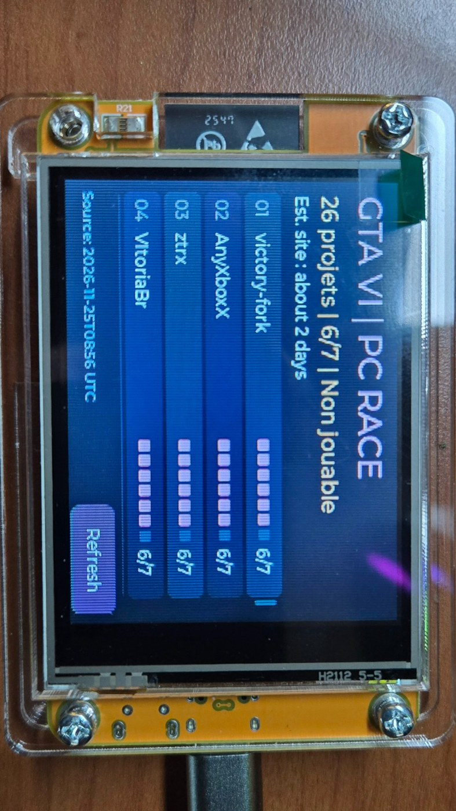

# GTA6-CYD-Tracker 🌴

**WELCOME TO LEONIDA** — an unofficial GTA VI PC Race desktop tracker for the ESP32 Cheap Yellow Display (CYD).



*Photo of an earlier working prototype; the current release adds automatic pagination and an animated boot screen.*

## Features — v1.4.1

- Animated sunset-themed boot screen with palms and a loading bar.
- Six ranked projects per page, automatically cycling every 10 seconds.
- Touch left/right to change pages, center to pause or resume.
- Automatic data refresh every 15 minutes and manual Refresh button.
- Wi-Fi status, refresh countdown, and source timestamp in Belgian local time (including daylight saving time).
- Green highlight for projects whose stage has increased.
- Last successful standings cached in ESP32 flash for offline viewing.
- French interface and translation of common estimate phrases.

## Hardware

ESP32-2432S028R (2.8-inch CYD), 320 × 240 landscape display, ILI9341 LCD and XPT2046 resistive touch. Other CYD variants may need different pin mappings or display settings in `include/lgfx_cyd.h`.

## Installation (PlatformIO)

1. Install [Visual Studio Code](https://code.visualstudio.com/) and the [PlatformIO IDE extension](https://platformio.org/install/ide?install=vscode).
2. Download or clone this repository and open its root folder in VS Code.
3. Copy `include/config.example.h` to `include/config.h` and enter your 2.4 GHz Wi-Fi SSID and password in the new file. Do not publish this file.
4. Connect the CYD using a USB data cable.
5. Select the `gta6` PlatformIO environment, build and upload.
6. Follow the touch calibration prompts on first boot.

From a PlatformIO terminal, the equivalent commands are:

```sh
pio run -e gta6
pio run -e gta6 -t upload
pio device monitor -b 115200
```

If upload fails, check the USB cable, serial port and driver. To recalibrate, hold BOOT just after reset (not during hardware reset, which can enter flashing mode).

## Controls

| Control | Action |
| --- | --- |
| Left side of standings | Previous page |
| Center of standings | Pause/resume auto-pagination |
| Right side of standings | Next page |
| Refresh | Request updated standings |

## Data and limitations

Data comes from the public HTML of [GTA6 PC Race](https://vuyp.github.io/gta6-pc-race/#standings), maintained at [vuyp/gta6-pc-race](https://github.com/vuyp/gta6-pc-race). This project is an independent display client, not the source of the standings. The site estimates and stages are unofficial; 7/7 is not independent proof that a playable PC release exists. The HTML parser depends on the upstream layout and supports up to 40 ranked entries. If the layout changes or the limit is exceeded, updates may fail. The firmware retains the last valid snapshot when possible.

HTTPS currently uses `setInsecure()` (no server certificate verification). This is a prototype for public data only; network responses can be tampered with. Do not use it for sensitive data. Wi-Fi credentials are compiled into the firmware; do not distribute a binary built with your real credentials.

## Credits

- Standings and estimates: [vuyp / GTA6 PC Race](https://github.com/vuyp/gta6-pc-race).
- Display and graphics: [LovyanGFX](https://github.com/lovyan03/LovyanGFX), [LVGL](https://github.com/lvgl/lvgl).
- GTA VI and related names belong to their respective owners. This fan project is not affiliated with Rockstar Games or Take-Two Interactive.

## License

MIT for the original tracker code, subject to the repository owner's approval before publication. Third-party components retain their own licenses.
